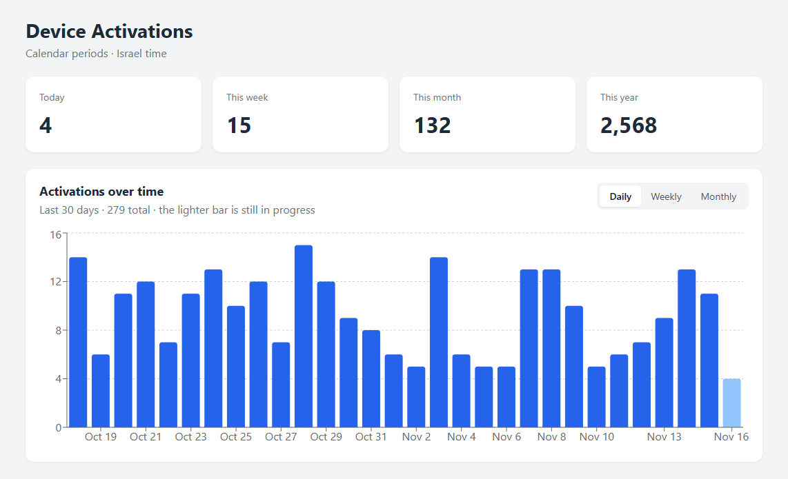

# Device Activations Dashboard

A back-office dashboard that shows how many devices were activated today, this week, this month and this year, with a chart of activations over time.

Each device sends a single ping to the server the first time it is activated. The server stores it once, and the dashboard reads aggregated counts from the API.



## Tech stack

- **Frontend:** React 19, TypeScript, Vite, Recharts
- **Backend:** Python, FastAPI, SQLAlchemy
- **Database:** SQLite (can be swapped for PostgreSQL)
- **Tests:** pytest

## Running locally

Requirements: Python 3.10+ and Node.js 18+.

### 1. Backend

```bash
cd backend
python -m venv .venv
.venv\Scripts\activate          # Windows
# source .venv/bin/activate     # macOS / Linux
pip install -r requirements.txt

python -m app.seed --reset      # optional: 3,000 fake activations over the last 400 days
uvicorn app.main:app --reload
```

The API runs on http://127.0.0.1:8000, with interactive docs at http://127.0.0.1:8000/docs.

### 2. Frontend

In a second terminal:

```bash
cd frontend
npm install
npm run dev
```

Open http://localhost:5173. In development, Vite forwards `/api` requests to the backend, so no CORS setup is needed.

### 3. Tests

```bash
cd backend
pytest -v
```

## API

| Method | Path                                               | Description                                           |
| ------ | -------------------------------------------------- | ----------------------------------------------------- |
| `POST` | `/api/activations`                                 | Register a device activation (the ping)               |
| `GET`  | `/api/stats/summary`                               | Counts for today, this week, this month and this year |
| `GET`  | `/api/stats/timeseries?granularity=day&buckets=30` | Counts per day, week or month, for the chart          |

**Register an activation**

```json
POST /api/activations
{ "device_id": "abc-123", "activated_at": "2026-11-16T08:00:00Z" }
```

`activated_at` is optional; if it is missing, the time the server received the ping is used.
Returns `201` with `"is_new": true` for a new device, or `200` with `"is_new": false` if the device was already registered.

**Summary**

```json
{
  "today": 4,
  "week": 15,
  "month": 132,
  "year": 2568,
  "timezone": "Asia/Jerusalem"
}
```

**Timeseries**

```json
{
  "granularity": "month",
  "timezone": "Asia/Jerusalem",
  "points": [
    { "bucket_start": "2025-12-01", "count": 180 },
    { "bucket_start": "2026-01-01", "count": 196 }
  ]
}
```

## Design decisions

**Calendar periods.** "This week" starts on Sunday (the Israeli work week), "this month" on the 1st and "this year" on January 1st, rather than rolling windows like "the last 7 days". This matches how a manager reads the numbers ("how many activations did we have this month?").

**Time zones.** All times are stored in UTC. Period boundaries are computed in Israel time (`Asia/Jerusalem`, including daylight saving), then converted to UTC for the query. Without this, a device activated at 01:30 in Israel would be counted on the previous day.

**No double counting.** `device_id` is the primary key, so the database itself rejects a second row for the same device. A repeated ping returns `200` with the original activation time, so the endpoint is idempotent. If two pings for the same device arrive at the same moment, the second insert fails on the unique key, and the endpoint catches that and returns the existing record.

**Half-open intervals.** Each period is counted as `[start, end)`: the start is included, the end is not. An activation at exactly midnight belongs to one day only. There is a test for this case.

**Empty periods are zeros.** The timeseries returns every period in the range, including those with no activations, so the chart has no gaps.

**Activation time vs. received time.** Each device stores both `activated_at` (reported by the device) and `created_at` (when the server received the ping). If a device was activated offline and sent the ping later, it is counted at its real activation time.

**Testable time.** The statistics functions take `now` as a parameter instead of reading the clock, so tests can run against a fixed date (Monday, Nov 16 2026) and always produce the same result.

**Frontend.**

- A small `useFetch` hook handles loading and error states and cancels outdated requests with `AbortController`, so a slow old response cannot overwrite a newer one when switching chart views.
- The last bar in the chart is drawn lighter, because the current period is still in progress and would otherwise look like a drop.
- The frontend has no hard-coded server address; it calls `/api/...` and the Vite proxy forwards it.

## Trade-offs and what I would do next

- **Database.** SQLite keeps setup to zero for a reviewer. For production I would switch to PostgreSQL by setting the `DATABASE_URL` environment variable, and add migrations (Alembic) instead of `create_all`.
- **Scale.** The timeseries runs one indexed `COUNT` query per period (up to 30). That is fast for this size, but with millions of devices I would use a single `GROUP BY` query with `date_trunc ... AT TIME ZONE` in PostgreSQL, or keep a daily summary table updated in the background.
- **Security.** The ping endpoint is open, so anyone could register fake activations. In production, devices would authenticate (for example, a signed token per device), and the dashboard would sit behind a login.
- **Validation.** Activations with a timestamp in the future are not counted, but they are still stored. I would reject timestamps that are far in the future when the ping arrives.
- **Frontend.** Auto-refresh every minute, a custom date range, and breakdowns (for example by device model or app version), if the ping includes that data.
- **Deployment.** Docker Compose with one container for the API and one for the frontend.

## Project structure

```
backend/
  app/
    main.py        # API endpoints
    database.py    # Database connection
    models.py      # Device table
    schemas.py     # Request and response shapes
    stats.py       # Period and timeseries calculations
    seed.py        # Fake data for local development
  tests/           # API and calculation tests
frontend/
  src/
    api.ts                       # Types and fetch helper
    hooks/useFetch.ts            # Loading, error and cancellation
    components/KpiCard.tsx       # A single number
    components/ActivationsChart.tsx
    App.tsx
```

## How I worked

I started by clarifying the requirements (the ping is sent once, on first activation) and writing down the decisions above before writing code. I then built the project in small steps, one commit per step: backend endpoints first, then the seed script, then the dashboard, then tests.

I used an AI assistant as a guide while building: to review my plan, explain parts of FastAPI, SQLAlchemy and Recharts that I had not used before, and help debug errors. The design decisions (calendar periods, time zone handling, how to prevent double counting) were mine.
